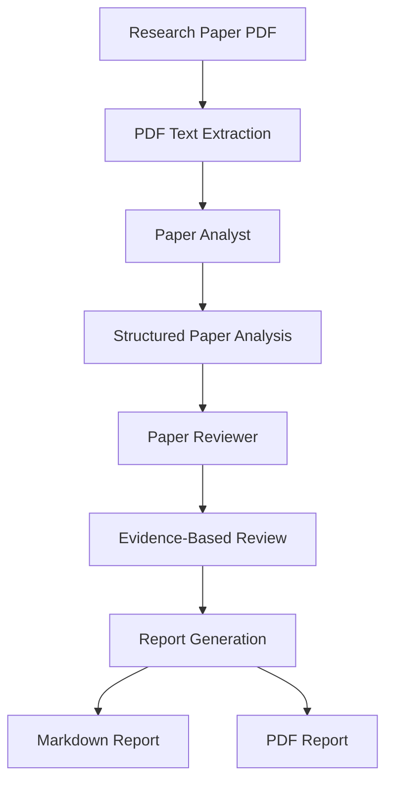

# PaperPilot Atlas

### Research Intelligence Workspace

**Navigate Research. Discover Intelligence.**

PaperPilot Atlas is an AI-powered research intelligence application designed to help researchers understand, analyze, and critically evaluate scientific papers.

The platform uses a sequential two-agent workflow to transform research papers into structured analysis and evidence-grounded reviews.

---

## Overview

Understanding research papers often requires substantial time spent extracting methodology, interpreting results, identifying contributions, and evaluating limitations.

PaperPilot Atlas streamlines this process through two specialized AI agents:

- **Paper Analyst:** Extracts and organizes the paper's key information into a structured research analysis.
- **Paper Reviewer:** Evaluates the analysis against the source paper, checks supporting evidence, identifies unsupported claims, and provides methodological critique.

The outputs are compiled into structured research reports that can be downloaded in Markdown and PDF formats.

## Key Features

- PDF research paper upload
- AI-powered research paper analysis
- Structured research information extraction
- Methodology and experimental setup analysis
- Dataset and results examination
- Research contribution identification
- Evidence-based claim verification
- Unsupported claim identification
- Missing information detection
- Methodological critique
- Strengths and limitations assessment
- Research insights and future research questions
- Markdown report generation
- PDF report export
- Interactive Streamlit interface

## Architecture

PaperPilot Atlas follows a sequential two-agent architecture.



The Analyst produces the initial structured analysis.

The Reviewer evaluates that analysis using the available source text and identifies verification results, missing information, unsupported claims, methodological concerns, and further research opportunities.

The final reports combine both outputs.

## Technology Stack

| Component | Technology |
|---|---|
| Programming Language | Python |
| User Interface | Streamlit |
| Agent Framework | LangChain |
| Workflow Orchestration | LangGraph |
| LLM Provider | Groq |
| Model | GPT-OSS 120B |
| Data Validation | Pydantic |
| PDF Processing | PyMuPDF |
| Report Generation | ReportLab |
| Environment Management | uv |

## Project Structure

```text
paperpilot-atlas/
├── app/
│   ├── agents/
│   ├── models/
│   ├── services/
│   ├── tools/
│   ├── workflow/
│   └── streamlit_app.py
├── data/
│   └── uploads/
├── outputs/
├── tests/
├── .gitignore
├── README.md
├── requirements.txt
└── pyproject.toml
```

## Getting Started

### 1. Clone the repository

```bash
git clone https://github.com/AbdulMajad805/PaperPilot-Atlas.git
cd paperpilot-atlas
```

### 2. Create a virtual environment

Using uv:

```bash
uv sync
```

If the project does not contain a `pyproject.toml`:

```bash
uv venv
```

Activate it on Windows:

```powershell
.venv\Scripts\Activate.ps1
```

Install dependencies:

```bash
uv pip install -r requirements.txt
```

### 3. Configure environment variables

Create a `.env` file in the project root:

```env
GROQ_API_KEY=your_groq_api_key
GROQ_MODEL=openai/gpt-oss-120b
```

Never commit your `.env` file.

### 4. Run the application

```bash
uv run streamlit run app/streamlit_app.py
```

The application will be available locally at:

```text
http://localhost:8501
```

## Deployment

PaperPilot Atlas is designed to be deployed using
[Streamlit Community Cloud](https://share.streamlit.io/).

Deployment requires:

- A GitHub repository
- Application dependencies
- Secure Groq API credentials
- Streamlit Community Cloud configuration

## Current Version

**Version:** v1.0.0  
**Status:** Initial development release

### Current Workflow

PDF Upload → Paper Analyst → Paper Reviewer → Research Report

## Future Development

Planned improvements for future versions include:

- Cloud-based research library
- Persistent paper and analysis storage
- Supabase integration
- Research history and retrieval
- Enhanced evidence tracing
- Improved full-document analysis
- Advanced research intelligence features

## Security

- API credentials are stored outside source code.
- Environment files are excluded from version control.
- Research papers and generated reports are excluded from the repository by default.

## Author

**Abdul Majid**

AI Engineer | Computer Science Graduate

---

PaperPilot Atlas — Research Intelligence Workspace
